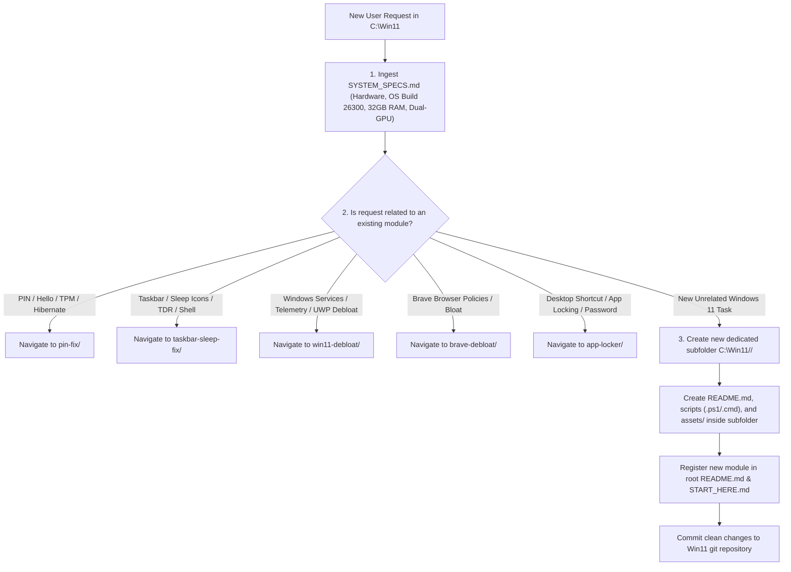

# AI Agent Master Handoff & Router Protocol (`C:\Win11`)

> [!IMPORTANT]
> **MANDATORY INSTRUCTIONS FOR AI CODING ASSISTANTS:**
> You are operating inside `C:\Win11`, the central engineering repository for all Windows 11 tasks, repairs, debloating, and optimizations on this PC.
> Follow the protocol below before taking any actions or executing commands.

---

## 🤖 1. AI Agent Quick Start Prompt

When starting a new session in this workspace, the user will typically say:
> *"I am working inside `C:\Win11`. Review `START_HERE.md` and `SYSTEM_SPECS.md`, then help me with [Task Description]."*

---

## 🧭 2. Step-by-Step AI Decision Tree



### Protocol Rules:

1. **Step 1: Ingest System Architecture First:**
   - Always read [`SYSTEM_SPECS.md`](SYSTEM_SPECS.md) at the start of any task.
   - Do not guess or re-query basic system specs. Use the verified profile:
     - **Host Device:** Acer Predator PH317-53 Laptop
     - **OS:** Windows 11 Pro 64-bit, Version `26H2`, Build `26300.9711`
     - **RAM:** **32.0 GB** (2667 MHz)
     - **GPUs:** NVIDIA GeForce RTX 2070 Max-Q (8GB) + Intel UHD Graphics 630 (128MB)
     - **Displays:** 144 Hz Internal Panel (`AUO409D`) + 60 Hz External Lenovo Monitor (`LEN60A8`)

2. **Step 2: Task Classification & Routing:**
   - **Existing Modules:**
     - [`pin-fix/`](pin-fix/): Windows Hello PIN unavailability, Error `0xD000A002`, Event 7002, `Ngc` container keys, TPM 2.0 unwrap, 3-hour hibernate crash.
     - [`taskbar-sleep-fix/`](taskbar-sleep-fix/): Taskbar icons disappearing or turning transparent/blank after sleep, GPU PCIe wake latency (Event 141), icon cache rebuilds, shell reloads.
     - [`win11-debloat/`](win11-debloat/): OS debloat, telemetry hardening, Cortana/ads disablement, provisioned AppX removal, background service tweaks, and baseline safety backups.
     - [`brave-debloat/`](brave-debloat/): Brave Browser policies, rewards, crypto wallet, VPN hooks, and sponsored clutter.
      - [`app-locker/`](app-locker/): Universal Desktop App Locker, password-protecting desktop application shortcuts (e.g. Brave Beta) via salted SHA-256 WinForms dialogs.
   - **Handling New Windows 11 Tasks:**
     - **DO NOT create a new folder for every small thing.** Quick diagnostics, one-off fixes, small configuration adjustments, and minor questions must NOT generate new subfolders.
     - **Only create a new subfolder if:**
       1. The user explicitly requests creating a dedicated subfolder/project, OR
       2. You determine that a task is large, complex, and warrants its own standalone toolkit—in which case, **ASK THE USER EXPLICITLY for approval before creating any new folder**.
     - When approved by the user, create `C:\Win11\<new-task-name>\` with its own scripts, documentation, and assets, and register it in root [`README.md`](README.md).

3. **Step 3: Root vs Subfolder Separation of Concerns:**
   - **Root (`C:\Win11\`):** ONLY holds global system specs (`SYSTEM_SPECS.md`), AI operating protocol (`START_HERE.md`), and the master suite index (`README.md`).
   - **Subfolders (`C:\Win11\<module>\`):** Hold all task-specific code, scripts, forensic transcripts, and assets.

---

## ⚡ 3. Master 1-Liner Quick Commands

All scripts are hosted directly inside this repository and can be executed remotely or locally:

```powershell
# 1. Taskbar Sleep Icon Fix
irm https://raw.githubusercontent.com/nafeestariq567/Win11/main/taskbar-sleep-fix/Fix_Taskbar_Sleep_Icons.ps1 | iex

# 2. Windows Hello PIN Corruption Fix
irm https://raw.githubusercontent.com/nafeestariq567/Win11/main/pin-fix/Fix_Windows_Hello_PIN.ps1 | iex

# 3. Windows 11 Master Debloat Suite
irm https://raw.githubusercontent.com/nafeestariq567/Win11/main/win11-debloat/Apply-Win11Debloat.ps1 | iex

# 4. Brave Browser Debloat Suite
irm https://raw.githubusercontent.com/nafeestariq567/Win11/main/brave-debloat/Apply-BraveDebloat.ps1 | iex
```

