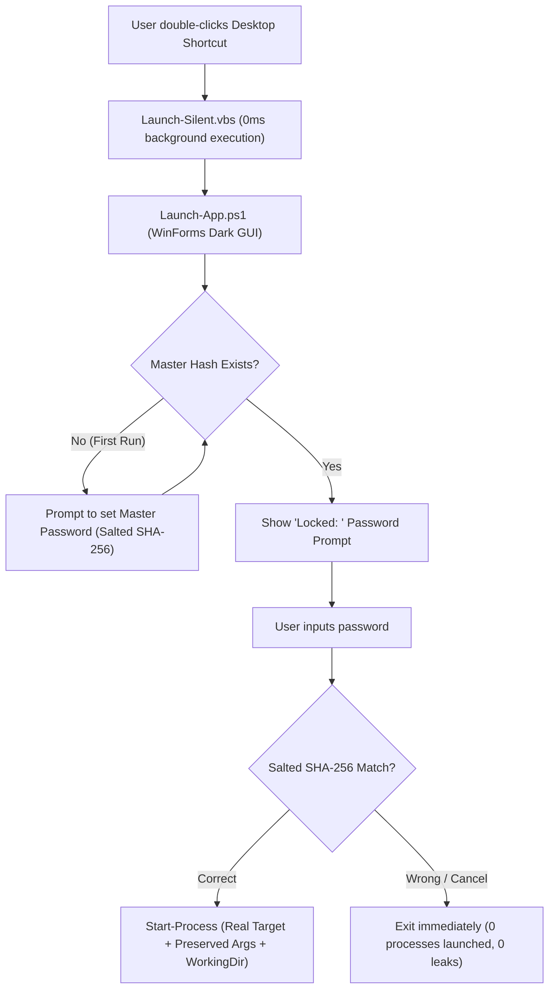

# Universal Desktop App Locker (`app-locker`)

A lightweight, zero-overhead desktop application locker for Windows 11. Protects private applications (such as **Brave Beta**, Telegram, Discord, or games) from guests, children, or unauthorized persons sitting at your PC with a secure **Master Password**.

---

## 🧭 Features & Design Philosophy

- **Universal Application Support:** Works with any desktop shortcut (`.lnk`). Automatically extracts and preserves the target binary, working directory, and custom launch arguments (such as `--proxy-server="socks5://127.0.0.1:40000"` for Brave Beta).
- **Zero Visual Disruption:** The desktop shortcut retains the exact same name and high-resolution icon. To anyone looking at your desktop, it looks completely original.
- **Native Zero-Console GUI (`AppLocker.exe`):** Compiled as a native Windows GUI subsystem binary (`/target:winexe`). Never opens a command prompt or console window, starts in < 30ms, and bypasses Windows scripting host limitations.
- **Modern Fluent Dark GUI:** Presents a sleek, centered, dark-themed password dialog matching Windows 11 aesthetics.
- **Cryptographic Security:** Passwords are never stored in plain text. Stored as a **salted SHA-256 hash** (`config/master.hash`).
- **Fail-Safe & 100% Reversible:** Original `.lnk` shortcuts are backed up upon locking, allowing instant 1-click restoration to direct execution at any time.

---

## 🏗️ Architecture & Launch Flow



---

## 🚀 Quick Launch & Usage

### 1. Lock Any Desktop App
Run the interactive locker:
```powershell
powershell -NoProfile -ExecutionPolicy Bypass -File "C:\Win11\app-locker\Lock-App.ps1"
```
*Or double-click [`Lock-App.cmd`](Lock-App.cmd).*  
It displays all desktop apps with numbers (`[1] Brave Beta`, `[2] Chrome`, etc.). Select the number and press Enter.

To lock a specific app directly via command:
```powershell
powershell -NoProfile -ExecutionPolicy Bypass -File "C:\Win11\app-locker\Lock-App.ps1" -ShortcutName "Brave Beta"
```

---

### 2. Unlock / Restore Any App to Normal
To permanently restore a shortcut to direct execution:
```powershell
powershell -NoProfile -ExecutionPolicy Bypass -File "C:\Win11\app-locker\Unlock-App.ps1"
```
*Or double-click [`Unlock-App.cmd`](Unlock-App.cmd).*

---

### 3. Reset Master Password
If you ever want to change or clear the master password:
```powershell
powershell -NoProfile -ExecutionPolicy Bypass -File "C:\Win11\app-locker\Reset-Password.ps1"
```
*Or double-click [`Reset-Password.cmd`](Reset-Password.cmd).*

---

## 📁 File Structure

```text
C:\Win11\app-locker\
├── README.md               # Documentation & architecture breakdown
├── START_HERE.md           # Quick start guide & AI router instructions
├── Launch-App.ps1          # Universal modern WinForms password prompt & launcher
├── Launch-Silent.vbs       # Silent execution stub (zero console flicker)
├── Lock-App.ps1            # Auto-inspects desktop shortcuts, backs them up, & applies lock
├── Lock-App.cmd            # 1-click interactive lock launcher
├── Unlock-App.ps1          # Reverts locked shortcuts back to direct execution
├── Unlock-App.cmd          # 1-click interactive unlock launcher
├── Reset-Password.ps1      # Interactive master password manager
├── Reset-Password.cmd      # 1-click password reset launcher
├── config/                 # Stores master password salt and SHA-256 hash
│   └── master.hash
└── apps/                   # Stores individual app JSON profiles and backup .lnk files
    ├── brave-beta.json
    └── brave-beta.original.lnk
```
