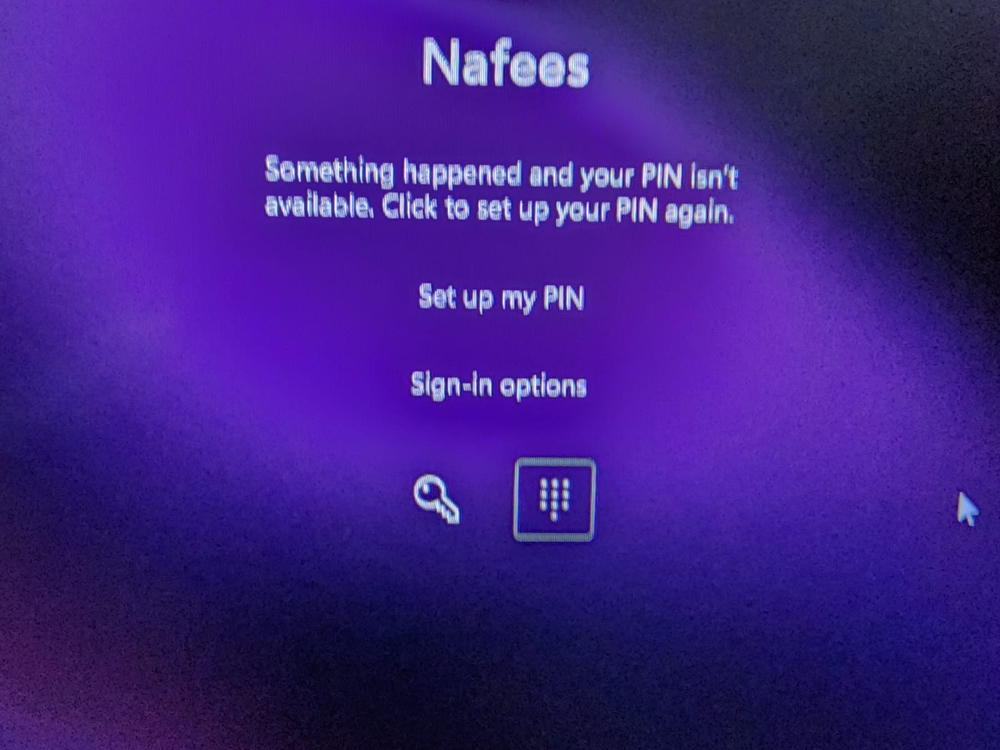

# Windows 11 PIN & Hello Corruption Resolver

An automated, forensic-grade toolkit to diagnose and permanently resolve the notorious Windows Hello error: **"Something happened and your PIN isn't available. Click to set up your PIN again"** (Event ID 7002, Error `0xD000A002`).

Tailored and verified on an **Acer Predator Laptop (Windows 11 Pro 64-bit)**.

---

## ⚡ Instant Fix (PowerShell One-Liner)

To resolve this issue immediately on any affected Windows 11 PC, open **PowerShell as Administrator** and paste:

```powershell
irm https://raw.githubusercontent.com/nafeestariq567/Windows11-PIN-Fix/main/Fix_Windows_Hello_PIN.ps1 | iex
```

---

## 📸 The Problem

Every few days or on system wake, Windows lock screen displays:

> *"Something happened and your PIN isn't available. Click to set up your PIN again."*



Even if you enter Windows via your password, remove the PIN, or change the PIN in Windows Settings, **the error returns after a few days**. Restarting the computer does not resolve it.

---

## 🔍 Forensic Root Cause Breakdown

Through deep Windows Event Log inspection (`Microsoft-Windows-HelloForBusiness/Operational` and `System`), the exact chain of failure was uncovered:

### 1. The Immediate Failure (Event ID 7002)
```text
Log Name:      Microsoft-Windows-HelloForBusiness/Operational
Event ID:      7002
Description:   Failed to load an existing Windows Hello container.
ID:            {adf8549c-f058-42f4-b6ee-108f81b610d0}
Error:         0xD000A002
```
Windows Hello stores PIN keys inside an encrypted container in `C:\Windows\ServiceProfiles\LocalService\AppData\Local\Microsoft\Ngc`. When this container is corrupted, Windows Hello rejects the PIN.

### 2. The Recurring Trigger: 3-Hour Sleep-to-Hibernate Resume Crash
Historical logs (`8/28`, `9/2`, `9/6`, `10/17`, `10/19`, `10/21`) revealed that every PIN failure occurred immediately after:
```text
Event ID 16 (Kernel-Boot):  Windows failed to resume from hibernate with error status 0xC0000225 / 0xC000A002.
Event ID 41 (Kernel-Power): The system has rebooted without cleanly shutting down first.
```
- In default Windows Power schemes, **"Hibernate after" is set to 3 hours (10,800 seconds)** (`HIBERNATEIDLE`).
- When the laptop is left sleeping for more than 3 hours, Windows attempts to transition from standard Sleep to Hibernate.
- On Acer Predator and various gaming laptop NVMe/RAM controllers, the resume transition fails (`0xC0000225`), causing a kernel crash reboot.
- This dirty crash breaks TPM 2.0 unwrap state and corrupts the active `Ngc` container on disk.

### 3. Why Settings Fails to Fix It:
When you attempt to change or remove your PIN via `Settings > Accounts > Sign-in options`, Windows asks the TPM to decrypt the existing container `{adf8549c...}` to authorize the modification. Because the container is corrupted, the request fails silently or leaves orphaned keys, trapping the user in a recurring loop.

---

## 🛠️ The 2-Part Permanent Solution

This toolkit executes a 2-part permanent fix:

1. **Purges Corrupted Cryptographic Keys:**
   - Takes administrative ownership of `C:\Windows\ServiceProfiles\LocalService\AppData\Local\Microsoft\Ngc` (`takeown` and `icacls`).
   - Safely wipes the damaged container and orphaned key files.
   - Restarts `VaultSvc` (Credential Manager) and `NgcCtnrSvc` (Passport Container).
2. **Neutralizes the 3-Hour Crash (Root Cause):**
   - Sets `Hibernate after` to **Never (`0`)** on both AC and Battery:
     ```cmd
     powercfg /SETACVALUEINDEX SCHEME_CURRENT SUB_SLEEP HIBERNATEIDLE 0
     powercfg /SETDCVALUEINDEX SCHEME_CURRENT SUB_SLEEP HIBERNATEIDLE 0
     powercfg /SETACTIVE SCHEME_CURRENT
     ```
   - Recreates clean hibernation memory mapping (`powercfg -h off` followed by `powercfg -h on`).
   - Your laptop now stays in clean, stable standard S3 sleep and never crashes on wake.
3. **Launches Clean PIN Provisioning:**
   - Opens Windows Sign-in options automatically so you can set your new PIN in a clean, healthy state.

---

## 🚀 Alternative Execution (1-Click Local Launcher)

If you have cloned this repository locally:

1. Double-click [`Run_Fix_PIN_Admin.cmd`](file:///C:/Windows11-PIN-Fix/Run_Fix_PIN_Admin.cmd) (and accept the UAC elevation prompt).
2. The terminal will automatically clean `Ngc` and adjust the power settings.
3. When **Sign-in options** opens, click **PIN (Windows Hello) > Set up**, and enter your PIN.

---

## ✅ Live Verification Proofs

After running the fix on the host machine:
- **Event 5225:** `Creating Windows Hello key with result: 0x0` (Success)
- **Event 5702:** `Windows Hello wrote protector properties: PIN protector = true` (Success)
- **Event 5001:** `A user signed into the device successfully using PIN!`
- **Power Settings:** `HIBERNATEIDLE = 0x00000000` (Permanently disabled)
- **Error 7002:** `0 occurrences`
