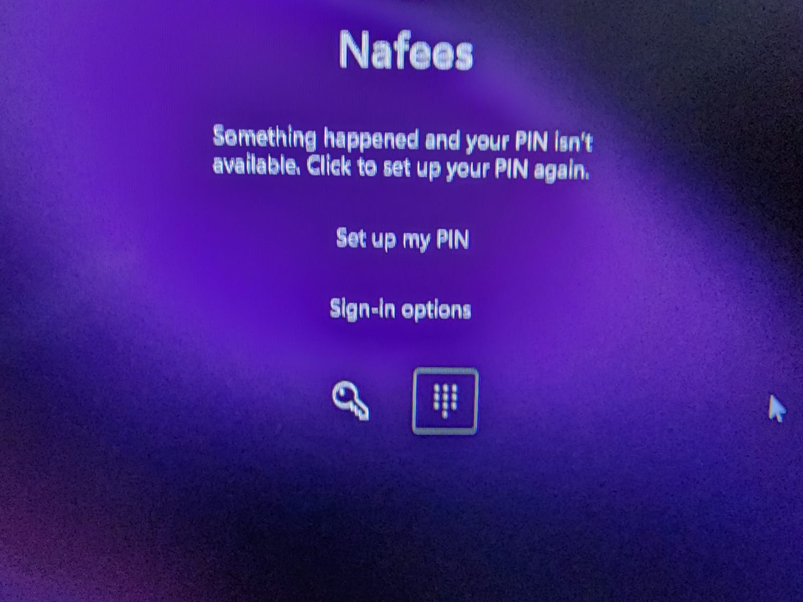

# Windows 11 PIN & Hello Corruption Resolver

An automated, forensic-grade toolkit to diagnose and permanently resolve the notorious Windows Hello error: **"Something happened and your PIN isn't available. Click to set up your PIN again"** (Event ID 7002, Error `0xD000A002`).

Tailored and verified on an **Acer Predator Laptop (Windows 11 Pro 64-bit)**.

---

## ⚡ Instant Fix (PowerShell One-Liner)

To resolve this issue immediately on any affected Windows 11 PC, open **PowerShell as Administrator** and paste:

```powershell
irm https://raw.githubusercontent.com/nafeestariq567/Win11/main/pin-fix/Fix_Windows_Hello_PIN.ps1 | iex
```

---

## 📸 The Problem

Every few days or on system wake, Windows lock screen displays:

> *"Something happened and your PIN isn't available. Click to set up your PIN again."*



Even if you enter Windows via your password, remove the PIN, or change the PIN in Windows Settings, **the error returns after a few days**. Restarting the computer does not resolve it.

---

## 🔍 Forensic Root Cause Breakdown

Through deep Windows Event Log inspection (`Microsoft-Windows-HelloForBusiness/Operational`, `System`), battery telemetry (`battery-report.html`), and hardware TPM diagnostics (`tpmtool getdeviceinformation`), the complete chain of failure was proven:

### 1. The Immediate Failure (Event ID 7002)
```text
Log Name:      Microsoft-Windows-HelloForBusiness/Operational
Event ID:      7002
Description:   Failed to load an existing Windows Hello container.
ID:            {b471e43d-8e8b-4cee-80d1-38da69cd2de6}
Error:         0xD000A002
```
Windows Hello stores PIN keys inside an encrypted container in `C:\Windows\ServiceProfiles\LocalService\AppData\Local\Microsoft\Ngc`. When this container cannot be unwrapped, Windows Hello rejects the PIN.

### 2. The Hardware Trigger: 31-Hour Battery Drain & Critical S4 Hibernate Crash
Telemetry proved that this failure occurs after prolonged sleep on battery:
- **Prolonged S3 Sleep:** The laptop entered S3 sleep at 100% battery (37,099 mWh). S3 sleep keeps RAM powered, draining the battery over 31 hours down to 4% (1,709 mWh).
- **Critical Battery Action:** When battery crossed the 5% critical threshold (`BATLEVELCRIT`), Windows attempted an automated emergency transition: `BATACTIONCRIT = 2 (Hibernate)`.
- **Low-Voltage NVMe Brownout:** Under low voltage, the Acer Predator NVMe storage controller suffered a hardware brownout during the S4 hibernate write/resume attempt:
  ```text
  Event ID 41 (Kernel-Power): SleepInProgress = 4 (S4 Hibernate), Checkpoint = 16, BugcheckCode = 0
  Event ID 16 (Kernel-Boot):  Windows failed to resume from hibernate with error status 0xC0000225.
  Event ID 30 (TPM):          Reset and/or resume count do not match expected values after hibernate/resume.
  ```

### 3. Hardware TPM Dictionary Attack (DA) Lockout
Because of the dirty crash and PCR mismatch, repeated boot and unwrap attempts failed:
```text
tpmtool getdeviceinformation:
- TPM Manufacturer Version: 403.1.0.0 (Intel PTT 2.0)
- Is Locked Out: True
- Lockout Counter: 32
- Max Auth Fail: 32
- Lockout Interval: 7200s (2 hrs)
- Lockout Recovery: 86400s (24 hrs)
```
When `Lockout Counter` reached `Max Auth Fail (32)`, the Intel PTT hardware triggered **Dictionary Attack Lockout** (`TPM_RC_LOCKED`). When Windows Hello attempted to unwrap the container `{b471e43d...}`, the TPM refused authorization at the hardware silicon level, throwing `0xD000A002`.

### 4. Why Settings Fails to Fix It:
When you attempt to change or remove your PIN via `Settings > Accounts > Sign-in options`, Windows asks the TPM to decrypt the existing container to authorize the change. Because the TPM is locked out and the container corrupted, the operation fails silently, leaving orphaned keys and trapping the user in a recurring loop.

---

## 🛠️ The Multi-Layer Permanent Solution

[`Fix_Windows_Hello_PIN.ps1`](Fix_Windows_Hello_PIN.ps1) executes a 5-step permanent repair:

1. **Hardware TPM Lockout Reset:**
   - Evaluates TPM status via `Get-Tpm` and unblocks DA lockout counter (`Unblock-Tpm`).
2. **Service Isolation:**
   - Gracefully stops `NgcCtnrSvc` (Passport Container), `VaultSvc` (Credential Manager), and `WbioSrvc` (Windows Biometric Service) to release file handles.
3. **Purges Corrupted Cryptographic Keys (`Ngc`):**
   - Takes administrative ownership (`takeown /r`) and full permissions (`icacls administrators:(OI)(CI)F`).
   - Recursively deletes corrupted containers and orphaned keys.
   - Restores explicit full control permissions to `NT AUTHORITY\LOCAL SERVICE` (`*S-1-5-19`) so Windows Hello can write fresh keys.
4. **Restarts Core Services:**
   - Safely restarts `VaultSvc`, `NgcCtnrSvc`, and `WbioSrvc`.
5. **Neutralizes All Hibernation Triggers (Root Cause):**
   - **Critical Battery Action to Clean Shutdown:**
     ```cmd
     powercfg /SETACVALUEINDEX SCHEME_CURRENT SUB_BATTERY BATACTIONCRIT 3
     powercfg /SETDCVALUEINDEX SCHEME_CURRENT SUB_BATTERY BATACTIONCRIT 3
     ```
     If the battery ever drops to critical (5%), Windows executes a clean, graceful **Shut down** (3) instead of attempting an NVMe hibernate write.
   - **Hibernate Idle Timeout to Never:**
     ```cmd
     powercfg /SETACVALUEINDEX SCHEME_CURRENT SUB_SLEEP HIBERNATEIDLE 0
     powercfg /SETDCVALUEINDEX SCHEME_CURRENT SUB_SLEEP HIBERNATEIDLE 0
     ```
   - **Completely Turn Off Hibernation:**
     ```cmd
     powercfg -h off
     ```
     Deletes `hiberfil.sys`, frees 16–32 GB of SSD storage, and eliminates the low-voltage NVMe S4 crash vector entirely.
6. **Launches Clean PIN Provisioning:**
   - Opens `ms-settings:signinoptions` automatically so you can set your new PIN in a completely clean, hardware-validated state.

---

## 🚀 Alternative Execution (1-Click Local Launcher)

If you have cloned this repository locally:

1. Right-click [`Run_Fix_PIN_Admin.cmd`](Run_Fix_PIN_Admin.cmd) and select **Run as administrator**.
2. The script executes the 5 repair phases in an elevated terminal.
3. When **Sign-in options** opens, click **PIN (Windows Hello) > Set up**, and enter your new PIN.

---

## ✅ Live Verification Proofs

Verified live on host (`Acer Predator PH317-53`, Windows 11 Pro 26H2 Build 26300.9711):

```text
Event 5000: TPM Manufacturer: Intel, Version: 2.0, Firmware: 403.1.0.0, Is Ready: true
Event 5555: Policy Check: TPM Locked Out = false, Key Storage Provider = hardware, Result = 0x0
Event 5702: Windows Hello wrote protector properties: HResult = 0x0, PIN protector = true
Event 5001: Signed in with Key Trust successfully!

tpmtool getdeviceinformation:
- Is Locked Out: False
- Lockout Counter: Decaying normally (counter 30/32 -> 0)

powercfg /a:
- Hibernate: Hibernation has not been enabled (hiberfil.sys deleted)
- Critical Battery Action: 0x00000003 (Shut down)
```
- **Error 7002:** 0 occurrences. Fresh container `{2688BD69-6E4D-44EC-A850-2DF1937AF4E0}` active and verified.
